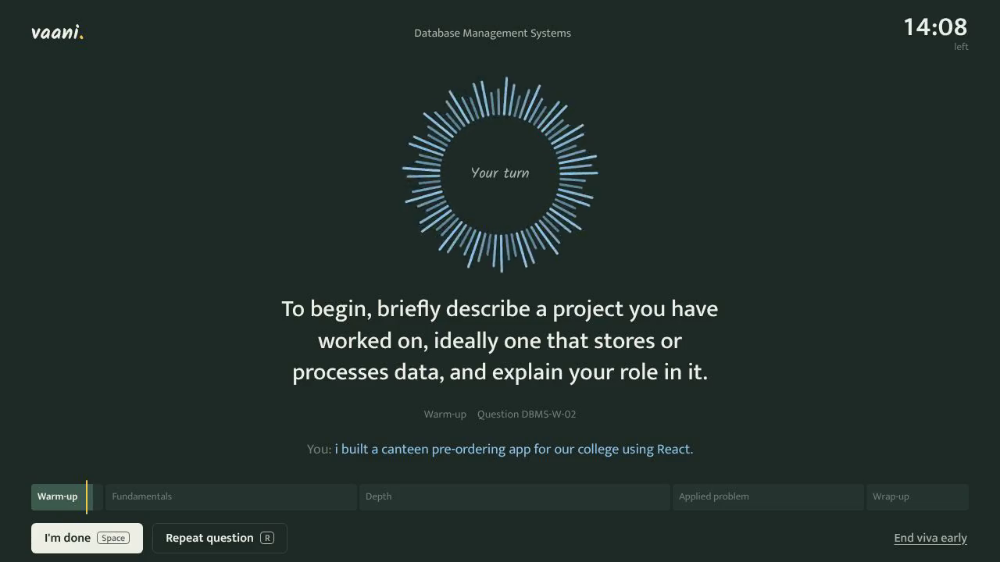
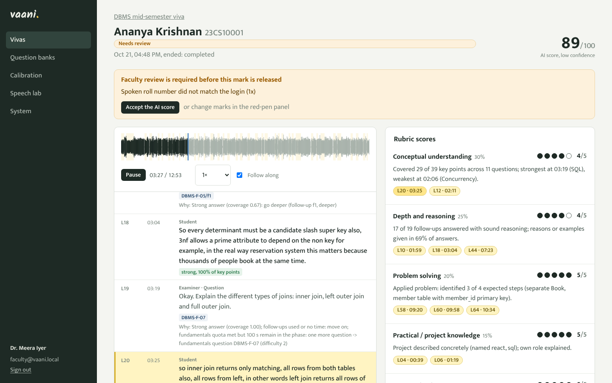
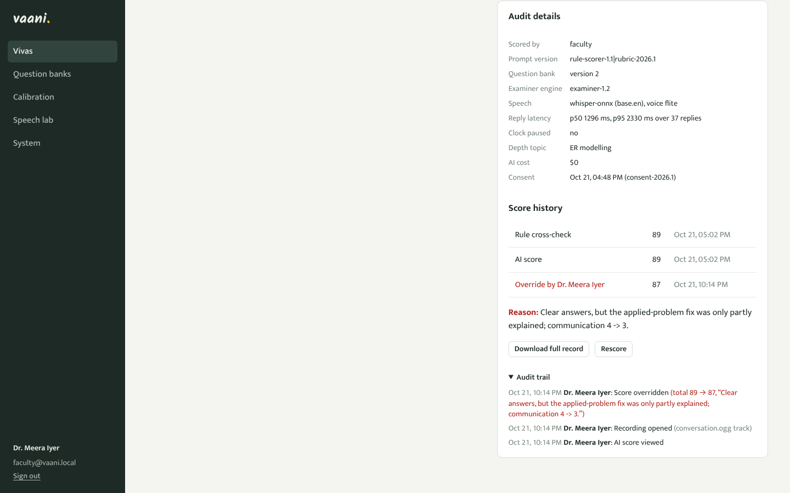
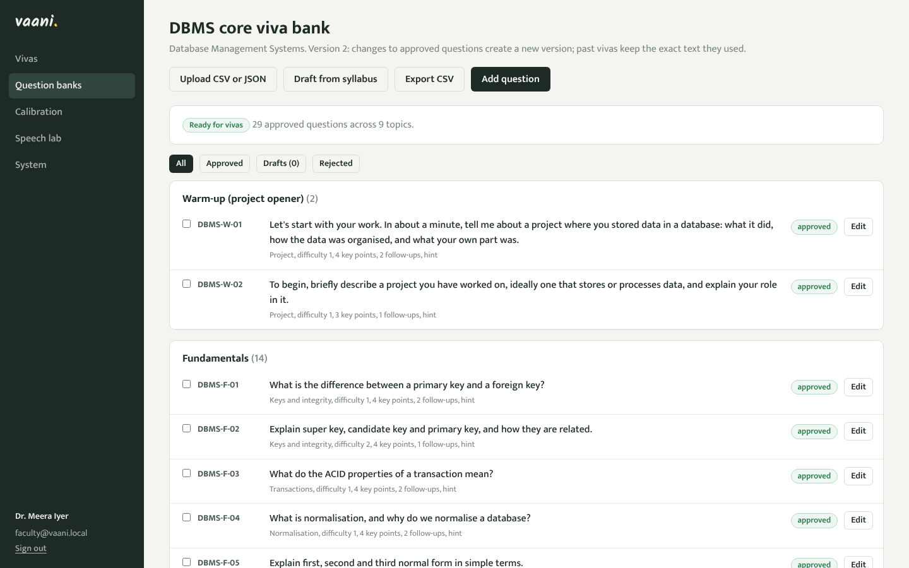
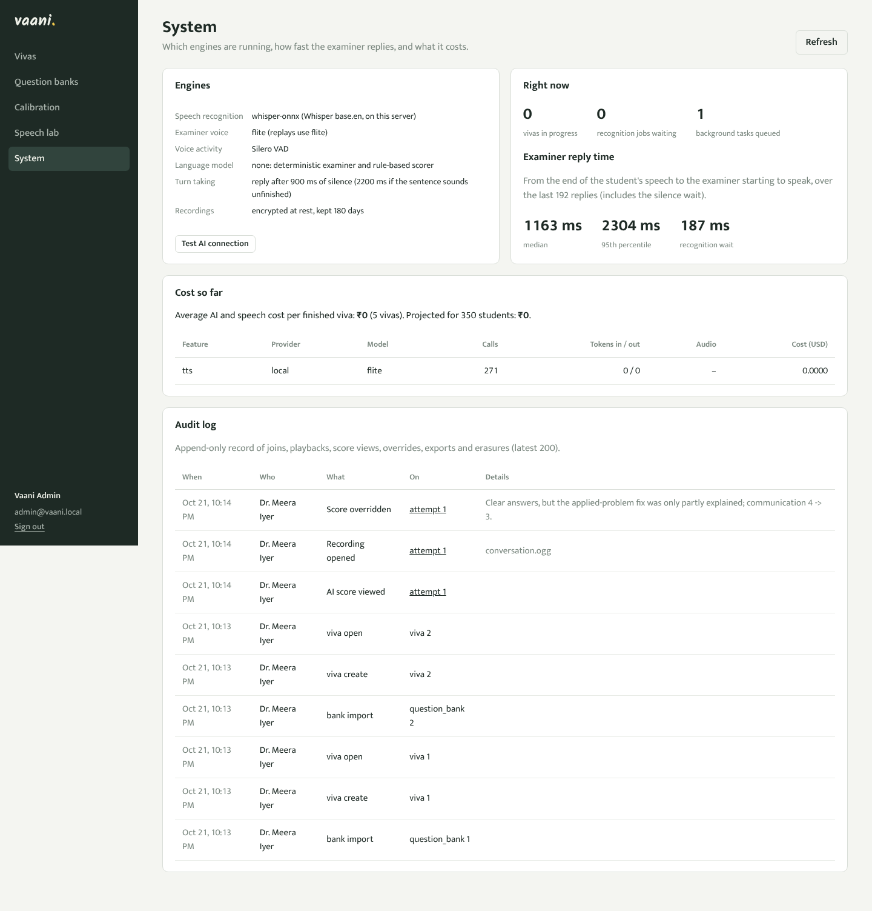

# Vaani: an AI examiner for oral vivas

Vaani runs a 15-minute viva by voice. It asks questions from the faculty's own question bank, listens to the
student's spoken answers, follows up the way a good examiner does (deeper after a strong answer, one hint after a
partial one, moving on after "I don't know"), never gives the answer away, and stops at exactly 15 minutes. Then it
scores the viva against the rubric, linking every mark to the transcript line and timestamp that justify it, and
keeps the recording, the transcript, the questions and the scoring reasons so that faculty can listen, check and
override any mark with a reason.

It runs fully offline on a college server (speech recognition included), or with hosted speech and AI models when
an API key is added.



**Demo video (2:48, with sound):** [`docs/demo/vaani-demo.mp4`](docs/demo/vaani-demo.mp4): a student takes a viva by voice
(local Whisper, server voice), then faculty review a recorded viva, change a mark with a reason, and open the audit trail.

## Try it

```bash
docker compose up --build          # then open http://localhost:8000
```

or without Docker (Python 3.11+, ffmpeg recommended):

```bash
./run.sh                           # Windows: powershell -ExecutionPolicy Bypass -File run.ps1
```

| Who | How to get in |
|---|---|
| Student | Open the home page, enter viva code **DBMS26** (or **OSYS26**), any roll number and your name, allow the microphone. Chrome, Edge or Firefox. |
| Faculty | `/login` with **faculty@vaani.local** / **faculty123**. Five recorded sample vivas are already in the DBMS viva. |
| Administrator | **admin@vaani.local** / **admin12345** (change `ADMIN_PASSWORD` in `.env`). |

The first start downloads nothing if you used Docker (the speech models are in the image); `run.sh` downloads
Whisper base.en and the voice detector once (about 200 MB). No API key is needed for anything.

**Deploy your own copy** (fork, then Render or your own server, with every feature on): step-by-step guide in
[`docs/DEPLOY_GUIDE.pdf`](docs/DEPLOY_GUIDE.pdf) ([`docs/DEPLOY.md`](docs/DEPLOY.md)).

## What it does

| The brief asks for | In Vaani | Where |
|---|---|---|
| Question bank by CSV/JSON upload, or AI-generated from a syllabus with faculty approval | Upload, editor with leak check for hints, syllabus generator (drafts only, approve each), versioned banks | Faculty: Question banks; `docs/QUESTION_BANK.md` |
| Student ID login, rules screen, consent | Viva code + roll number, rules, microphone and speaker check, recorded consent (version, time) | `/` |
| Voice interview: TTS questions, STT answers, reply in under ~2 s | Streaming recognition while the student talks; reply p95 under 2.5 s on 2 vCPU with local Whisper | `docs/DESIGN.md` §2 |
| Adaptive follow-ups that never reveal the answer | Key-point assessment per answer; strong → deeper, partial → one hint, "I don't know" → move on, off-topic → redirect, misconception → probe; leak guards on every line | `app/engine/` |
| Hard 15-minute limit with a visible timer | Phase plan 0-1-5-10-13-14:30, hard stop at 15:00, 90 s per answer, network pauses handled | Viva room |
| Rubric scores 30/25/20/15/10, 0-5 each, reasons linked to timestamps, total /100, 3-5 feedback lines | Rule scorer + AI scorer (median of 3 runs, citation-checked); every reason cites transcript lines | `app/scoring/` |
| Persist audio, transcript, questions, scoring reasoning | Encrypted recording (student track and mixed conversation), transcript with sources, plan snapshot, all scoring runs and prompt versions | `data/` |
| Faculty dashboard: list, play audio, read transcript, override with reason | Attempt list with review queue, audio with waveform and synced transcript, evidence highlighting, override in red pen, audit trail, CSV and Google Sheets export | Faculty: Vivas |
| Stretch: code round, integrity, Hindi/Hinglish, calibration, export | Code shown for debugging questions, integrity signals (never auto-penalised), Hinglish answers accepted and recognised, blind faculty marks + calibration page, CSV/Sheets | |

## Results

All measured; the full method and data are in [`docs/TEST_REPORT.md`](docs/TEST_REPORT.md).

| What | Result |
|---|---|
| Reply time, one viva, local Whisper base.en on 2 vCPU | **p50 1.15 s, p95 1.65 s** over a full viva (target p95 < 2.5 s); it was 2.5 / 4.3 s before streaming recognition |
| Reply time, 5 vivas at once on the same 2 vCPU | p50 1.0 s, p95 2.2 s, max 2.9 s over 192 replies |
| Examiner behaviour in the 5 recorded vivas | 198 of 198 lines traceable to the bank or a named system line; 0 evaluative lines; a hint after 23 of 23 partial answers, never a second; 43 of 43 "I don't know" answers moved on without pressure; a deeper follow-up after 29 of 31 strong answers |
| Scores of the 5 recorded vivas | strong 89, Indian-English phrasing 91, average 50, weak 19, "I don't know" 7 |
| Speech recognition, Indian-accented English (NPTEL2020, 99 clips) | WER 14.7% with Whisper base.en on the server's CPU (16.4% with tiny.en) |
| Scoring vs reference marks (14 simulated vivas) | MAE 4.75 / 100, Pearson 0.98; identical marks over 5 runs; standard vs Indian-English phrasing within 3 points |
| Load test (hosted speech recognition) | **150 concurrent vivas** on one 2-vCPU machine, reply p95 1.9 s, nothing dropped; breaking point about 200 |
| Capacity with local Whisper | 6 concurrent vivas on 2 vCPU (3 per core) within the latency target |
| Robustness | network drop + rejoin, noisy room, muted microphone, silent student: all recovered (`docs/TEST_REPORT.md` §6) |
| Cost for 350 students | ₹135 of server time with no API at all; ₹227 with hosted open-weight models; ₹2,317 with OpenAI's premium models ([`docs/COST.md`](docs/COST.md)) |
| Automated tests | 108, all passing (under a minute, no network) |

## Screenshots

| Faculty review: audio with waveform, synced transcript, evidence-linked rubric scores | Override in red pen, score history and audit trail |
|---|---|
|  |  |
| **Question bank** (upload, syllabus drafts, versions, readiness check) | **Administrator audit log** and system status |
|  |  |

## How it works

```
browser mic ──16 kHz PCM over WebSocket──▶ voice detector ─▶ streaming Whisper ─▶ examiner state machine
     ▲                                                                              │
     └──────────── pre-synthesised examiner voice + captions + timer ◀──────────────┘
after the viva: mix-down → integrity signals → rule scorer + AI scorer → review queue → faculty
```

The examiner is a deterministic state machine (no LLM on the critical path), so it is fast, testable and cannot be
talked into revealing answers; an LLM is optional for rewording follow-ups (with a 1.4 s budget and leak checks)
and for the second scorer. Details: [`docs/DESIGN.md`](docs/DESIGN.md).

## Configuration

Everything works with no settings. The main choices (`.env`, see `.env.example`):

| Setting | Options | Default |
|---|---|---|
| `STT_ENGINE` (speech-to-text) | `whisper-onnx` (local), `groq`, `openai`, `sarvam` (Hinglish), `faster-whisper`, `browser` | local Whisper when downloaded |
| `WHISPER_MODEL` | `tiny.en`, `base.en`, `small.en`, `base` (multilingual) | `base.en` |
| `TTS_ENGINE` (examiner voice) | `browser`, `flite`, `piper`, `openai`, `sarvam` | `browser` |
| `LLM_PROVIDER` (scoring, follow-up wording) | `groq`, `openai`, `ollama` (local), `mock` (rule scorer only) | automatic from the keys present |
| `DATABASE_URL` | SQLite (default) or `postgresql://...` | SQLite in `data/` |
| `RETENTION_DAYS` | days to keep recordings | 180 |

Faculty can also choose the engines, language (English or Hinglish), difficulty, topics, rubric weights and phase
timings per viva.

## Repository

```
app/            server: live sessions, examiner engine, speech, scoring, API, task queue
  engine/       examiner state machine, answer assessment, phrases, LLM follow-up wording with leak checks
  voice/        Whisper ONNX recogniser, Silero VAD, TTS engines, audio and encryption helpers, WER
  scoring/      rubric, rule scorer, AI scorer, review flags, overrides, calibration
  data/         sample question banks, default rubric, prices
frontend/       React + TypeScript (built into app/static, no build needed to run)
tests/          108 unittest tests: engine, text, scoring, live WebSocket, API, voice
loadtest/       audio bots, load test, results
scripts/        model download, speech and scoring evaluations, cost sheet, sample export, report builder
samples/        five recorded vivas (audio, transcript, scores), question banks (JSON + CSV), rubric
docs/           design, test report, scalability, cost sheet, privacy note, question-bank guide
```

## Deliverables

| Deliverable | File |
|---|---|
| Repository with README and Docker Compose | this file, `docker-compose.yml`, `Dockerfile` |
| Design document (2 pages; limit 3) | [`docs/DESIGN.md`](docs/DESIGN.md), printable [`docs/DESIGN.pdf`](docs/DESIGN.pdf) |
| Sample question bank and rubric | [`samples/question_banks/`](samples/question_banks/), [`samples/rubric.json`](samples/rubric.json), [`docs/QUESTION_BANK.md`](docs/QUESTION_BANK.md) |
| Five recorded vivas | [`samples/vivas/`](samples/vivas/) (also loaded into the demo dashboard) |
| Test report | [`docs/TEST_REPORT.md`](docs/TEST_REPORT.md) |
| Load test and capacity plan | [`docs/SCALABILITY.md`](docs/SCALABILITY.md), `loadtest/` |
| Cost sheet for 350 students | [`docs/COST.md`](docs/COST.md) |
| Privacy note | [`docs/PRIVACY.md`](docs/PRIVACY.md) |
| Demo video | [`docs/demo/vaani-demo.mp4`](docs/demo/vaani-demo.mp4) |

## Running the tests and evaluations

```bash
python -m unittest discover -s tests -t .                     # 108 tests, under a minute, no network
python scripts/eval_scoring.py                                # scoring accuracy, consistency, fairness
python scripts/eval_scoring.py --llm --runs 5                 # the same for the AI scorer (needs an API key)
python scripts/eval_stt.py --n 100                            # WER on Indian-accented English (NPTEL2020)
python loadtest/run_bots.py --code DBMS26 --personas strong   # one full viva by an audio bot
python loadtest/load.py --code <viva> --pid <server pid>      # 50/100/150 concurrent vivas
python scripts/cost_sheet.py && python scripts/test_report.py # rebuild docs/COST.md and docs/TEST_REPORT.md
```

## Credits

Speech recognition uses OpenAI's Whisper models (MIT) in the ONNX export published by the sherpa-onnx project
(Apache-2.0); voice activity detection uses Silero VAD (MIT). Fonts: Mukta, Kalam and JetBrains Mono (SIL Open Font
License). The Indian-English evaluation uses the NPTEL2020 dataset by AI4Bharat (NPTEL lectures under a Creative Commons licence), downloaded on demand and
not redistributed. See [`CREDITS.md`](CREDITS.md).
